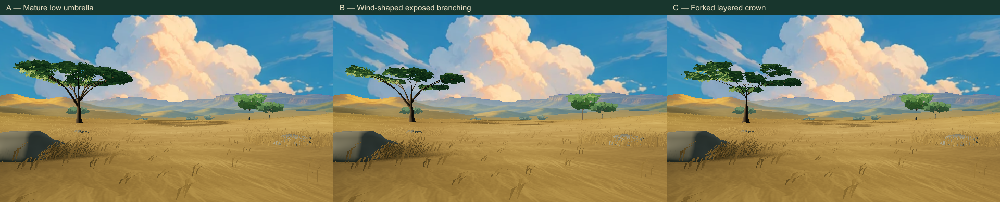

# Golden plains + procedural tree art direction

**Recommendation: A, provisionally.** Its mature umbrella silhouette is closer to the supplied references than the legacy pointed crown. B is a more open alternative; C's current tiered treatment is rejected. **No tree architecture or complete scene is human-approved.** Physical grass is cheaper and more dimensional, but midground noise remains; this is partial progress, not a claim that every completion criterion is solved.

[R2 before/after](before-after.png) · [Reference comparison](reference-comparison.png) · [Landscape stage](landscape-stage.png) · [Physical grass stage](grass-stage.png) · [Native thumbnails](thumbnails.png) · [Seeds29/41/73](seed-checks.png)

## Reference observations before implementation

[Saved image-led observations](01-reference-observations.json) distinguish direct reference evidence from inferred techniques. Actual inspected sources were the supplied illustrated savanna, supplied photographic savanna screenshot, and retained R2 images. The reference has broad golden land masses with cooler, lower-contrast distance; expansive plains with restrained relief; and a wide low acacia crown visibly supported by outward forks. The prior hero was taller/pointed, uniformly green and less clearly branch-led.

The photograph is user supplied and its original license remains unverified; it is a private visual reference, not new licensed training data. No outside imagery was scraped/downloaded. No machine learning model was trained.

## Phase 1 — palette and terrain

The opt-in `r-plains` family uses the supplied highlight/body/amber/shade/straw/haze pigments as **material guidance, not fixed display colors**. Ground and blades sample the same world fields. Overlapping smooth transitions, anchored to the encounter's world position, move toward middle gold over12–65m, distant straw over55–130m, and sage haze over110–185m. Existing exposure, sky and global light setup are preserved. Ochre was guidance; not every supplied swatch is used literally.

Added continuation relief is multiplied by0.5, matching the initial50% reduction hypothesis. The original inner terrain is already shallow and remains unchanged so camera, ecological tree positions and ground contacts stay aligned. Distant illustrated geology and terrain continuation remain. This is a reduction of the **added mid-distance apron**, not a claim that every near-ground amplitude was halved or that drainage was hydrologically regenerated. The stage was rendered and inspected before grass work; [its review](stage1-review.json) retains the limited/provisional judgment.

## Phase 2 — selective physical grass

The old broad strips are replaced only in `r-plains`:

- Midground: three low-detail curved blades per existing instance, with height progressively reduced over24–65m. No additional instance density was added.
- Near outcrop dressing: five cupped/tapered blades, more geometry for curvature, and seed heads in roughly one seventh of groups. Real blade edges replace rectangular card footprints.
- Far field: material/color dominates; small geometry becomes low and subdued. This is detail suppression, not a separately measured triangle-culling system.

Shared world pigment/texture/light fields connect roots to terrain. Grass does not cast individual hard card shadows. The first attempt produced dark separated marks and accidentally used the old edge material; this error and the failed image are preserved. The revision fixes material routing and uses broader midground normal response with more variation close up. [Grass critique](grass-review.json).

**Remaining:** small blades still read as scattered marks in places, and connected swaths are not fully convincing. Do not equate reduced geometry or sparse seed heads with artistic approval. [Native grass crop](grass-native-crop.png). No alpha-to-coverage was enabled on the non-MSAA renderer.

## Shared tree representation extension

The legacy acacia was not using the newer studio species hierarchy. Rather than introduce a savanna-only renderer, this pass extends **SpeciesDesign.visualGrammar** and the existing **HierarchyBuilder**. A profile generates the same `StudioStudy` segments/groups/fronds consumed by existing geometry, atlas, material, batching, picking and LOD functions.

[Engine-neutral architecture profiles](../../visual-lab/acacia-architectures.json) control trunk radius/taper/flare/lean/forking, leader topology, primary reach/levels/wind/gaps, secondary/terminal branching, branch-owned foliage width/orientation/coverage, palette, maturity/environment response and LOD thinning. Descriptors remain plain arrays/numbers/quaternions for future export; the current curve/math implementation uses Three.js and is not a Unity implementation.

Profiles are **visual architecture studies**, not new ecological species or measured botanical models. Only the selected hero's presentation model changes. Its ecological identity, id, location, rotation and independent individual/appearance seeds are retained; other trees use their original models. Maturity/wind controls have technical tests, but young/environment-response art has not been validated. Default hierarchy radius behavior remains unchanged unless the new profile explicitly supplies attachment/tip controls.

No solid spherical foliage masses were introduced: group radii are metadata/picking bounds. The rendered canopy uses curved branch-aligned upper/side sprays with the existing broadleaf atlas. That atlas is **not a dedicated acacia compound-leaf asset**, an explicit limitation of the material/detail study.

## Controlled candidates and diagnostics

| Candidate | Structural construction | Visual judgment |
|---|---|---|
| **A — mature low umbrella** | One curved/tapered bole, seven outward scaffolds, low crown levels, branch-owned inner shoots and connected outer coverage. | Strongest recognizable umbrella silhouette; retain provisionally. Still regular/flat in places, with some elevated crown openings. |
| **B — wind-shaped exposed** | Leaning bole, five wind-biased scaffolds, fewer/less occupied sectors and greater exposed branch space. | Distinct alternative, but too fragmented into pads for this reference; not approved. |
| **C — layered multi-mass** | Two leaders, eight scaffolds and staggered crown levels. | Structurally distinct but current foliage reads as separate floating tiers; reject this implementation. |

Each has actual **full hero, inspection, isolated silhouette, branch-only, foliage/material detail and secondary angle** captures:

- [A diagnostic sheet](diagnostics-A.png)
- [B diagnostic sheet](diagnostics-B.png)
- [C diagnostic sheet](diagnostics-C.png)
- [Legacy diagnostic sheet](diagnostics-baseline.png)

All candidates use the same world seed29, same hero individual seed171073434, appearance seed3394320064, position, camera, terrain and lighting. A/B/C share nominal height/radius and material vocabulary; their branch topology, initiation, reach/lean, leader structure and crown levels differ. They are not three density/size variants.

The branch-only diagnostic includes the full source skeleton. Normal scene LOD retains primary/secondary wood and omits some finest twigs, so the diagnostic is not a claim that every subpixel twig is drawn in every view. Attachment tests verify guides lie on owned wood paths; visual support still requires inspection, not merely that numerical test.

## Iteration history and findings

1. **Landscape stage:** warmer shared pigments, continuous distance fades and half added relief; provisionally retained after actual review.
2. **Grass first/revision:** first dark/noisy separated marks and a material-routing bug; fixed routing and distance/normal response. Retained with unresolved midground noise.
3. **Tree family R1:** all three had too-thin support and nearly horizontal terminal islands. Preserved as negative examples in `tree-r1-source/` and `tree-r1-review.json`.
4. **Shared tree correction R2:** opt-in retained junction/tip radii, outer secondary coverage, varied upper/side sprays and common material response. A improves most; B/C remain weaker. `tree-r2-source/` preserves this version.
5. **A-only structural correction:** inspection showed a large central crown opening/ring-like physical cast shadow. Upward inner branch-owned shoots add coverage without a generic central foliage blob. The opening is smaller/more structured but not eliminated; no further artistic iteration is automatic.

This used one grass correction and two tree corrections. A is a provisional recommendation, not a production promotion. The original R2 and rejected candidates remain accessible. [Final critique](final-review.json) separates improvement from good-enough approval.

## Materials and lighting

The hero has deeper green interiors and selective warmer exterior surfaces rather than a uniform bright-green tint. Normal orientation, branch-aligned spray rotation, crown fields and existing scene sun-facing attention participate. The existing painted key response is still part of the foliage shader: it is **not a fully physically based leaf BRDF or full leaf-to-leaf self-shadowing solution**. Trees cast atlas-masked physical ground shadows; interior shading remains artist-controlled. The ring-like shadow seen in inspection is caused by canopy gaps, not a circular ground stamp.

## Robustness and performance

A was inspected at seeds29,41,73 in hero and elevated views. It retains umbrella identity and the landscape remains open; seed41 still has more near terrain/grass obstruction than29. B/C are controlled seed29 studies only. Do not generalize them as robust across all seeds.

| Version | Calls | Submitted triangles |
|---|---:|---:|
| Retained R2 | 10 | 186,340 |
| Revised plains/grass, old tree | 10 | 98,980 |
| Final A, seed29 | 11 | 110,708 |
| B, seed29 | 11 | 106,072 |
| C, seed29 | 11 | 107,962 |
| Final A, seed41 /73 | 11 | 111,230 /110,962 |

Final A submits about**40.6% fewer triangles** than R2, with one extra draw call. Most savings come from distance-role grass geometry, not from assuming fewer draw calls or lower screenshot resolution reduces generation cost. Counts are renderer submissions; shadow-refresh work and memory overhead are not fully represented by that number.

**Measured alpha-overdraw proxy:** isolated tree at320×180, depth disabled, additive alpha-tested coverage versus complete spray surfaces. A averages about6.73 alpha layers per occupied pixel, peak23; B4.55, peak24; C3.98, peak15. A's estimated alpha rejection is74%; its whole spray surfaces average0.62 layers per screen pixel in that specific diagnostic. No saturation occurred. These are raster proxies, **not hardware fragment invocation counters or normal depth-tested scene cost**. C is cheaper in this proxy yet less attractive—an example of technical metrics not approving art.

New hero atlas is512×384, about1MiB as RGBA8+mips. Referenced color textures in the final A scene estimate about48.4MiB including hidden fallback textures; shadow maps/driver allocations are excluded. The existing sky, ground and hill artwork are reused. No new image-generated assets or dedicated acacia atlas were produced in this pass.

Frame reports retain submission and synchronous `gl.finish` wall samples, pixel ratio1, texture/geometry objects and antialias:false. These are headless desktop WebGL probes, not GPU timer queries, physical mobile-device FPS or mobile approval. Grass/whole-scene alpha overdraw was not separately instrumented. [Complete measurements](measurements.json).

## Preservation, repeatability and checks

The original R2 hero/inspection and five protected default images (savanna hero/inspection, Puget hero, rainforest hero/inspection) are **byte-identical** to their baselines. The final A seed29 render repeats both views byte-for-byte. Structural/appearance seeds are separate; profile tests verify deterministic descriptors, owned guide attachment and identity/location preservation. Cross-GPU floating-point pixel identity is not promised.

Targeted checks: `npx tsc --noEmit` passed; `npx tsx --test tests/tree-growth-profile.test.ts` **3 passed**; `node --test tests/visual-learning-lab.test.cjs` **5 passed**. No full lint/build suite, dependency addition, deployment, commit or push.

## Reusable grammars and evidence status

- [Landscape Color and Atmosphere Grammar](../../visual-lab/landscape-color-grammar.json)
- [Procedural Tree Visual Grammar](../../visual-lab/procedural-tree-grammar.json)
- [Shared evidence schema](../../visual-lab/visual-grammar.schema.json)

Each rule stores reference observations, implementation hypothesis, actual render evidence, result, limitations, applicable scope and status. Universal relationships are separated from acacia-specific envelopes/pigments/numbers. Attachment/structure, limited crown coverage/material findings and plains relief/pigment results have scoped **agent experimental support**. Midground swaths, age/environment art and extreme-distance LOD remain **proposed**. Terminal-only horizontal-pad construction is a **rejected** negative example. **Zero human-approved rules** were created; no model training is claimed.

## Preview and checkpoint

[Preview A](http://localhost:3001/explore?lat=-2.3&lon=35.2&habitat=grassland&conditional=1&seed=29&density=36&structure=grove-1&appearance=garden&wind=0&encounter=1&camera=human&composition=C&groundLighting=B&illumination=on&pretty=on&labCandidate=r-plains&treeStudy=A). Change `treeStudy` toB/C/baseline for controlled alternatives. `labCandidate=r-golden` without `treeStudy` retains R2; omit both for unchanged defaults. The existing orbit/inspection capability is preserved; the harness fixes explicit hero/inspection poses for comparison.

Changes: opt-in plains material/grass in `savanna-recipe.ts`; shared declarative growth in `studio/growth-profile.ts`, `SpeciesDesign` and `HierarchyBuilder`; existing library LOD extension; selected-tree wrapper and localized renderer/diagnostic hooks; capture harness, grammars, tests and evidence. Existing unrelated dirty work was preserved. No generalized world-generation rewrite or new UI was added.

**Recommendation: develop A**, especially more organic lobe variation/branch gesture and a dedicated small-leaf spray language. Keep grass noise and remaining crown gaps on the defect list. Which direction should we develop: **A, B, C, or reject all three?**
