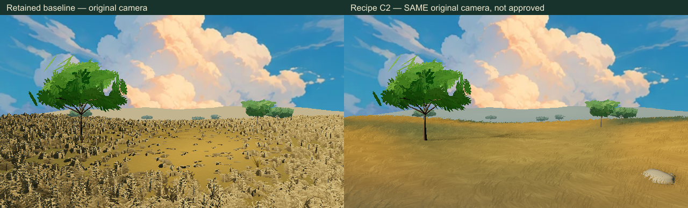
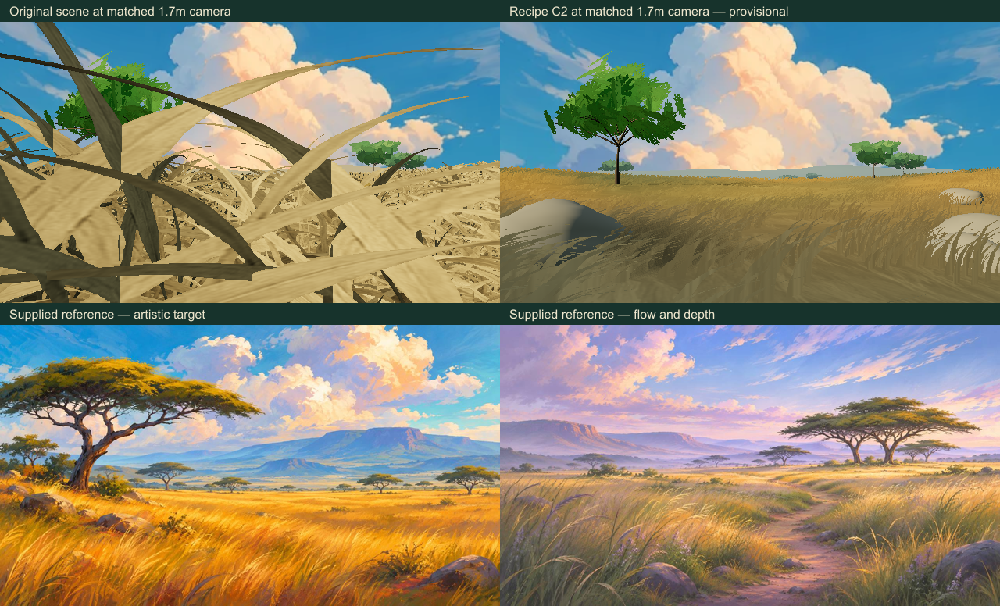

# Reference-to-Recipe savanna: partial visual progress, full scene not approved

**The painted surface and shared ground/grass relationships improve continuity, but the complete scene remains short of the supplied concepts. Gate C did not pass, and the diagnostic extra seeds reveal robustness failures. No new scene was promoted.** The approved Puget, rainforest and retained default savanna remain byte-identical. Earlier rejected S candidates remain intact negative examples.

The second sheet also shows why camera control matters: old dressing becomes an obstructing close tangle when brought to true eye height. Do not use that failure alone to exaggerate this pass's improvement. The first sheet compares old/new at the **same original camera**; the second compares old/new at the **same corrected 1.7m camera**. Primary tree population, geometry, sky and physical sun are identical within each pair.

## Deliverable index

- [Whole-reference analysis and previous failure classification](01-analysis.md).
- [Portable recipe schema](../../visual-lab/recipe.schema.json) and [recipe with rules, parameters, statuses and experiments](../../visual-lab/savanna-recipe.json).
- [Ground-only comparison](ground-comparison.png), [integrated grass comparison](grass-comparison.png), [foreground/contact comparison](foreground-comparison.png). Each includes hero and inspection.
- [Seeds 29, 41 and 73: hero and inspection](seed-checks.png), [multiscale thumbnails](thumbnails.png), [grass detail](grass-detail.png), [foreground detail](full-detail.png).
- [Performance, objective diagnostics, camera equality and protected-scene hashes](measurements.json); [seed critique](robustness-review.json).
- `gates/` retains every attempted source/version, exact parameters, images, objective metadata and actor-attributed review. `A1-review.json` through `C2-review.json` explain each decision. The separate unmodified S-r1/S-r2 records remain in `artifacts/visual-learning-lab/`.

## What the reference analysis changed

References organize an expansive warm field through cooler near masses, connected wind-swept vegetation, overlapping foreground stone/grass anchors and quieter distant layers. Fine blades support those relationships. The previous experiment too readily equated calmness with fewer marks: its material was bare, masses were rock-like, and hybrid strips exposed topology. Those implementations failed; the ideas of ground-first identity and coordinated material/growth fields were not disproved.

This pass declares a coordinated family: ground/distant-landform materials, decorative grass representation/distribution, added foreground clusters and contact response. It also corrects the **opt-in** camera after verifying a technical problem. Existing terrain vertices, ecological species selection, structural seeds, documented trees, sky and sun remain unchanged. Local material shading fields are world-space; there is no screen vignette, bloom or global color filter.

## Staged results and iteration history

| Gate | Attempts and decisions | Final judgment |
|---|---|---|
| A — ground | A1: painted surface improves grass identity, hierarchy too weak. A2: modest palette improvement, still insufficient. A3: broader brush scale/cool near/warm middle retained as a provisional foundation. | Useful surface improvement; not whole-scene beauty. Subsequent final review **narrowed** the initial support for broad value/frequency organization. |
| B — integration | B1: two strips too skeletal. B2: corrected camera reveals useful near scale, still thin. B3: wider groups improve growth but two-segment silhouette is triangular. B4: five-segment curved groups; initial A2C produces bright partial-alpha defects, repaired by disabling it on the non-MSAA renderer. | Narrow root/pigment integration passes provisionally; flat strip character and cost remain. No human approval. |
| C — composition | C1: black-looking stones worsen image. C2: one stone pigment/tint relationship, readable cool fill, cached-shadow refresh and shared irregular soil contact improve framing. | **Fails the full artistic gate:** smooth generic rocks, strip-like growth, simple background and existing tree silhouette still make the image schematic. |
| D — robustness | No new implementation. Diagnostic captures at 29/41/73, each hero/inspection. | **Not a gate pass.** Seed 41 overfills foreground and exposes the underside of the existing distant landform. |

A used initial + two corrections; B used initial + three corrections. The B4 technical alpha repair preserves the same construction and retains both failed and repaired captures/sources as one correction's preflight/repair evidence. C used initial + one correction and stops because the next useful work is a larger representation/art-direction investment; unused attempts are not spent automatically. No budget reset was used to continue the earlier S study. This user-authorized task has a separate named session and the staged per-gate budget requested in this brief.

## Concrete technical discoveries

1. **Camera height:** captured savanna camera was around `[0,5.4974,33.9767]`, with terrain near `-1.4900`: about **6.99m above ground**. The opt-in recipe uses seeded terrain +1.7m and permits the necessary OrbitControls polar angle. It is applied after population construction, so tree filtering/population is unchanged. Defaults retain their old camera. All corrected-camera controls share the same exact captured pose, aspect and settings.
2. **Alpha-to-coverage:** renderer uses `antialias:false`. Three's A2C alpha-test branch writes partial alpha without the opaque alpha override; the failed B4 capture had bright edge artifacts. Disabling A2C removes them without changing the construction. MSAA support is a prerequisite; this pass does **not** claim A2C edge softness. Aliasing remains possible.
3. **Stone response:** C1 multiplied a dark base by a dark instance tint. C2 fixes that actual pigment relationship and adds restrained cool emissive fill on stone only. No exposure increase hides the defect. This fixes blackness, not geological beauty.
4. **Shadows:** `shadowMap.autoUpdate=false` needed an explicit refresh for new/removed rock dressing. A small dirty flag now refreshes only when this experimental dressing changes. Grass receives existing physical shadows but casts no individual geometric shadows. Rock casts remain independent of art-directed pigment/contact fields.
5. **Surface identity:** generated painterly brush albedo reads more like continuous grassland before geometry. Shared world sampling coordinates bases, low growth and soil contact. This is a demonstrated local material relationship, not proof that the present complete composition is compelling.

## Actual visual review and limits

Vision-capable interpretation was available and used on actual supplied references, old candidate sheets, all gate hero/inspection views, extra seeds, final comparisons, native thumbnails and detail crops. Image capture/metadata/pixel metrics were kept distinct from that interpretation. Routine captures stayed at 640×360, thumbnails at 160×90, and detail checks used native crops. No higher-resolution render was necessary to identify these failures; **no 1920×1080 final was generated because the full scene was not accepted**.

At thumbnail scale the new land is more connected and less granular, but lacks the concept's strong intermediate light/shape rhythm. At 640px and detail scale fibres remain strips and rocks are smooth pale forms. Seed 41 exposes both framing overfill and disconnected distant geometry. The existing primary tree is less umbrella-like than the reference and the existing horizon remains simple. Those visible limitations justify a larger silhouette/continuation decision; they are not grounds to silently rebuild tree systems in this pass.

Lower-45% luminance standard deviation at 640px: new ground about **0.065**, grass **0.064**, full **0.093**, reference **0.144**. The full field is still too restrained in its value organization. Lower edge energy alone is not success. Reference content differs, so these diagnostics cannot determine approval or directly rank attractiveness. Geometry-only coverage excludes the painted substrate; raw zero ground coverage is retained, not misrepresented as missing terrain. Full seed-29 silhouette coverage is ~61.7% in the lower half with ~0.052% near-black masked pixels, but neither metric approves the scenery.

## Shared rule updates

Rules contain principle, direct reference evidence, intended effect, systems, inferred implementation, evaluation, confidence, biome constraints and reuse. Parameters are plain serializable data. Each experiment links exact images, seeds, source hashes and separate agent/human judgments.

- **Experimentally supported, narrow scope:** R4 root/world-pigment coordination; R9 physical camera/projected-scale validation; R10 matching edge technique to framebuffer capabilities. No human approvals exist.
- **Proposed:** R1/R3 broad value/frequency organization and R2/R5/R6/R7/R8 lighting/flow/anchors/depth/style implementations. Final whole-image review narrowed the earlier A3 support for R1/R3; those remain proposed rather than being generalized from a permissive preliminary gate.
- **Rejected:** N1, using lower edge density as an aesthetic objective. Failed S masses/patches, B strip variants, A2C without MSAA, C1 black stone, and seed-41 framing/continuation remain counterexamples.

The original gate critiques are preserved. Later evidence changes reusable support status rather than retroactively rewriting what was judged. Saved preferences/evidence do not mean model training occurred. Current human feedback is pending; no user approval was inferred.

## Rendering cost

| Version | Target instances | Calls | Submitted triangles |
|---|---:|---:|---:|
| Retained savanna | 11,000 grass | 8 | 57,350 |
| New ground only | 0 | 6 | 12,720 |
| Integrated fibres | 2,800 × six fibres | 7 | 180,720 |
| Full seed 29 | 3,040 grass groups + 15 rocks | 9 | 201,060 |
| Full seeds 41 / 73 | same dressing counts | 9 | 201,070 |

The full prototype costs **3.51×** the old submitted triangles for only provisional visual progress. Fewer instances do not imply less work: each fibre group contains 60 triangles. This increase is **not approved as a mobile default**. Any future adoption must justify silhouette benefit and use a cheaper distance representation. A shared native-1254px color texture is ~603KB WebP on disk; an uncompressed RGBA mip chain is approximately 8MiB, depending on renderer storage.

Submission/`gl.finish` wall samples are roughly 0–2.2ms here, not GPU timer queries, physical mobile frame rates or reliable throughput benchmarks. Counts come from `renderer.info` for the scene submission and exclude some shadow-refresh work. Full reports retain exact samples. No real-device/mobile FPS claim is made.

## Protection, determinism and checks

Default savanna hero/inspection, Puget hero and rainforest hero/inspection are **byte-identical** to saved baselines. A fresh final seed-29 recipe repeats both hero and inspection byte-for-byte; seeded layouts reproduce and non-target guards match for 29/41/73. Guards cover object/material identities, transform arrays and attribute versions, not a cryptographic proof of every possible shader behavior. Cross-GPU floating-point identity is not promised.

Targeted validation: `node --test tests/recipe-gates.test.cjs tests/visual-learning-lab.test.cjs` — **7 pass**; `npx tsc --noEmit` — pass. No full build/lint/test audit, dependency addition, deployment, commit or push. The saved sources and baseline snapshots make the work reversible without discarding earlier dirty workspace work.

## Asset and preview

New surface asset: [painted-fibre-v1.webp](../../public/assets/savanna-recipe/painted-fibre-v1.webp), generated with built-in `image_gen`. [Exact prompt, mode and provenance](asset-provenance.json). The requested 2048 output arrived at native1254px and was encoded without pretending to add resolution. The sampler uses **MirroredRepeat** for continuous edge values; the raw generated asset is **not claimed to have matching opposite edges**. [3×3 mirrored sampler preview](material-mirrored-3x3.png) exposes repeated curl/mirror motifs that require caution at other scales. Macro fields and detail suppression reduce their dominance in the tested views; the asset is not an approved universal production texture. No copyrighted references were scraped/downloaded or relicensed.

Preview locally at `http://localhost:3001/explore?lat=-2.3&lon=35.2&habitat=grassland&conditional=1&seed=29&density=36&structure=grove-1&appearance=garden&wind=0&encounter=1&camera=human&composition=C&groundLighting=B&illumination=on&pretty=on&labCandidate=r-full`. Use `r-ground` for ground only or `r-grass` for integration; remove `labCandidate` for the unchanged default. The recipe views use true eye height; the existing elevated inspection controls still work. Seeds 41 and 73 reproduce stress cases.

Source changes: new `src/lib/forest/savanna-recipe.ts`, portable `visual-lab/recipe.schema.json` / `savanna-recipe.json`, staged evidence helper and targeted tests; localized hooks in `visual-lab.ts`, `painted-renderer.ts`, `visual-quality.cjs` and the Lab controller. Source/tree/sky generators and approved scene configuration were not rewritten. `analyze.cjs` rebuilds comparison sheets/metrics from existing captures without regenerating scenes.

## Recommendation and checkpoint

**Retain the painted-ground experiment and diagnostic lessons; reject the current full scene for adoption.** The next worthwhile investment is a convincing continuous vegetation silhouette and weathered stone language, plus terrain-relative projected framing/continuation. Repeated width/density/tint tweaks are unlikely to solve those representation limits. Primary tree silhouette may also require a separately justified future art-direction decision; it was preserved here.

One question: **Keep this ground-led direction for a larger silhouette/rock/continuation experiment, or reject the direction?** Human decision is pending. The Lab is stopped at this checkpoint; unused correction attempts are not spent automatically.
