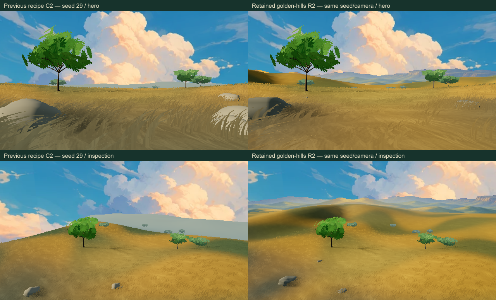

# Golden hills + foreground follow-up

**Retained R2, rejected the latest R3.** The scene has richer golden color, cool rolling hill/shadow variation, a cropped asymmetric left outcrop and a layered illustrated background. Foreground grass is still too planar to call the complete scene concept-quality. All changes are opt-in; the previous recipe, default savanna, Puget and rainforest remain unchanged.

[Ground/hills comparison](ground-comparison.png) · [Grass integration](grass-comparison.png) · [Foreground dressing](foreground-comparison.png) · [References and rotated view](reference-checkpoint.png) · [Seeds 29/41/73](seed-checks.png) · [160×90 thumbnails](thumbnails.png)

## Reference-to-recipe hypothesis

Your feedback—“close,” better colors, stronger foreground, more vibrancy and rolling golden hills/cool shadows—is saved as partial positive feedback, not blanket approval. The [starting hypothesis](01-hypothesis.json) identifies three reference relationships: asymmetric overlapping foreground weight; gold convex slopes against cool valley shadows; and layered geology connected to nearer terrain. The new implementation coordinates those relationships without changing sky, tree architecture/placement, ecological data or camera.

The implementation adds a cheap outer terrain apron and a world-space alpha-masked illustrated hill ring. Existing terrain vertices are untouched. The apron supplies real low rolling surface geometry and closes the old finite-ground/horizon gap. Shared ground/grass pigment is warmer and more saturated, with world-space cool shade regions. Foreground rock roles are asymmetric, seeded and limited by terrain-relative projected scale; lower central grass preserves the opening. The original `r-full` remains accessible and byte-identical.

## Generated hill artwork

[golden-ridges-v1.webp](../../public/assets/savanna-hills/golden-ridges-v1.webp), **2172×724 RGBA**, generated with built-in `image_gen`; [exact prompt and provenance](asset-provenance.json). The asset contains golden rolling foothills, blue-green shaded valleys and quieter distant escarpments, with transparent sky. It adds no sky/cloud asset. Color sampling is sRGB with mipmaps and anisotropy4; alpha-test0.1 cuts the distant skyline. The WebP is ~312KB; an uncompressed RGBA mip chain is approximately 8MiB.

The illustration wraps four times around a 145m-radius ring. **Its raw opposite edges are not seamless.** R1 exposed a hard Repeat seam and was rejected. Mirrored repeat fixes edge-value continuity in the tested views, but geological motifs may repeat and painted light may reverse under mirroring. Background illumination is baked artwork, not reconstructed dynamic terrain lighting. The 3D apron/near scene still use existing physical light and shadow systems plus art-directed world fields. This is economical distant presentation, not measured geography, a new sky, or a new renderer.

## Iteration and actual visual review

| Cycle | Visible result | Decision |
|---|---|---|
| R1 | More landscape depth/gold, but a vertical panorama seam; foreground still two separate modest boulders. | Revise. Saved source, images and [critique](r1-review.json). |
| R2 | Mirrored seam fixed; nonperiodic apron hill envelopes connect terrain; stronger gold/cool palette; partially cropped left outcrop and smaller secondary anchors. | Retain provisionally. [Critique](r2-review.json). |
| R3 | Reallocating the same edge batch into near banks creates opaque hedge-like foreground strips and hides the outcrop. | **Reject and restore R2.** [Critique](r3-review.json); failed source/images preserved. |

Three focused cycles were used. Source and parameter snapshots are in `baseline-source/`, `r1-source/`, `r2-source/`, `r3-source/`; [experiment record](experiment.json) stores source hashes and provenance. No failed latest version was promoted. Restored R2 hero and inspection are byte-identical to its earlier captures.

Actual vision-capable image interpretation was used on references, baseline/new hero/inspection, thumbnails, native detail crops, seeds41/73 and a rotated view. Routine renders stayed at640×360. Higher resolution was unnecessary to identify the remaining defects, and no1920×1080 final approval render was generated. Metrics support diagnosis, not artistic approval.

At thumbnail scale the new scene has richer landscape depth and gold; close detail still exposes planar fibres. The additional seeds retain a readable opening and avoid the old floating-horizon underside in the tested inspection camera. The rotated probe also has continuous land/hills. Seed41 still has taller near terrain/grass than29; projected constraints help but do not make every seed equally composed. Normal inspection is `[34,23,44]` looking toward `[-2,7,-12]`; the rotated probe is `[34,3.5,0]` toward `[-20,3.5,0]`, explicitly a continuity probe rather than a claim of exact1.7m eye height.

## Technical/artistic critique

[Final critique](final-review.json) separates “better” from full approval. Retained R2 is better for this pass's hill/palette goals, **not a fully approved scene**.

- **Major remaining:** foreground fibres look like planar strips; overlapping more of them worsens the image. The next useful foreground work is silhouette/overlap representation, not another density increase.
- **Minor remaining:** rocks are still simple stylized weathered forms; the tree silhouette remains unlike the concept's broad umbrella crown. Tree systems were deliberately preserved.
- **Minor remaining:** repeated/mirrored background illustration and baked light limit dynamic lighting/free-flight use. Standard encounter, inspection, two additional seeds and rotated continuity were tested, not unlimited camera travel.
- **Value organization:** lower-region HSV chroma ratio rises from about0.442 to0.572, reference about0.781. Luminance standard deviation falls from about0.093 to0.074, reference about0.145. More vibrancy does not mean foreground value hierarchy is solved; these differently composed images are descriptive comparisons, not aesthetic scores.

## Performance and preservation

| Version | Target instances | Calls | Submitted triangles |
|---|---:|---:|---:|
| Previous recipe C2 | 3,040 grass groups +15 rocks | 9 | 201,060 |
| New ground/hills stage | 0 | 7 | 19,600 |
| New grass stage | 2,200 groups | 8 | 151,600 |
| Retained R2, seed29 | 2,680 grass groups +15 rocks | 10 | 186,340 |
| Retained R2, seeds41/73 | same dressing counts | 10 | 186,350 |

The complete version submits **7.3% fewer triangles** than C2, with **one extra draw call** and an additional hill texture. Grass remains GPU-instanced; no per-tuft calls were introduced. Rebalancing reduces global grass while strengthening selected edges. Geometry is still substantially heavier than the original pre-recipe savanna; this is not a mobile-device performance approval. Wall-time submission/`gl.finish` probes are retained in [measurements](measurements.json), not reported as GPU timers or mobile FPS. Shadow-refresh work is not fully represented by steady submission counts.

Five protected default captures—savanna hero/inspection, Puget hero, rainforest hero/inspection—are byte-identical to their saved baselines. Old `r-full` also remains byte-identical to previous C2. All tested target-layout reproductions and non-target guards pass; no page/shader errors were captured. Guard scope is documented in each frame; it does not prove cross-GPU floating-point identity. Seeds, camera, sky, primary trees and render settings match within comparisons.

Targeted checks: `npx tsc --noEmit` passed; `node --test tests/visual-learning-lab.test.cjs` **5 passed**. No broad build/lint audit, dependency addition, deployment, commit or push.

## Reusable learning and approval status

The shared [recipe/schema](../../visual-lab/savanna-recipe.json) records:

- **GH1 — experimentally supported:** illustrated distant land needs geometric continuation and edge-continuous sampling. Scoped to tested views/seeds; regional illustration and fixed light remain limitations.
- **GH2 — experimentally supported:** coordinated material pigments/world regions increase useful vibrancy while preserving sky/tree systems. Not a universal saturation target or full-scene approval.
- **NGH1 — rejected:** concentrating these opaque strips near the camera guarantees natural foreground framing. R3 disproves that implementation despite unchanged counts.
- Foreground rock/grass representation and the broader value hierarchy remain proposed/unresolved. No new global rule is human-approved; saved records do not imply model training.

## Preview and files

[Open retained R2 locally](http://localhost:3001/explore?lat=-2.3&lon=35.2&habitat=grassland&conditional=1&seed=29&density=36&structure=grove-1&appearance=garden&wind=0&encounter=1&camera=human&composition=C&groundLighting=B&illumination=on&pretty=on&labCandidate=r-golden). Use `r-full` for the old recipe, `r-golden-ground` for the new ground/hill stage, `r-golden-grass` for integration; remove `labCandidate` for the unchanged default. Seeds41/73 reproduce the robustness checks.

Code changes are localized to `src/lib/forest/savanna-recipe.ts`, its declared-target hook in `visual-lab.ts`, and portable recipe data. New hill artwork, Lab feedback/rule records, comparison scripts and reports are stored alongside. Existing dirty work and old rejected experiments were preserved. `node artifacts/savanna-golden-hills/analyze.cjs` rebuilds sheets/diagnostics from saved images without generating scenes.

**Recommendation:** keep R2's hill/palette direction and provisional asymmetric outcrop; reject R3's hedge-like banks. Stop here for visual review. A future foreground pass should improve airy curved silhouettes and convincing rock/grass overlap before adding density. Is this the hill-and-color direction to keep?
