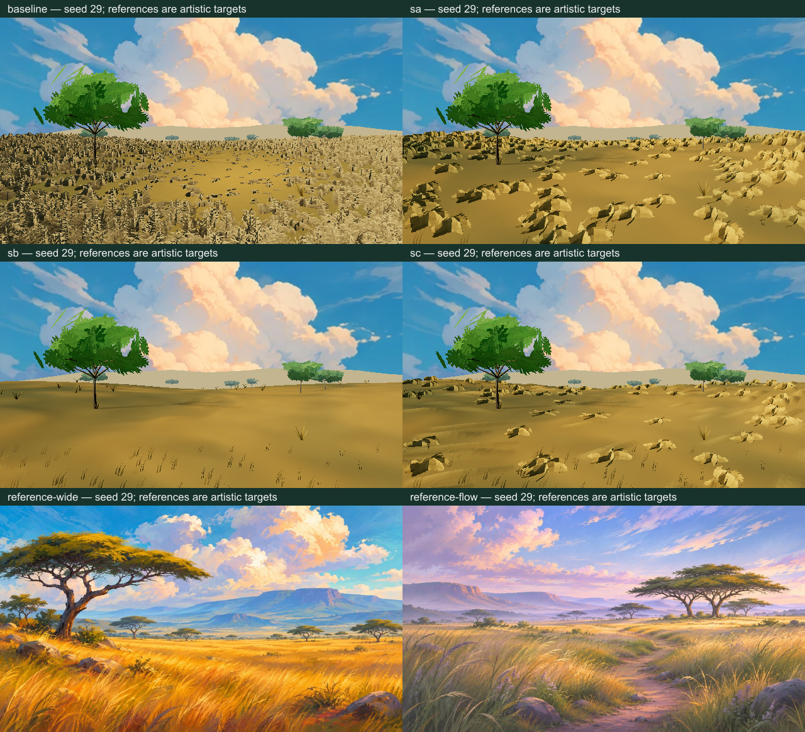

# Savanna representation checkpoint — seed 29

**Outcome: three distinct constructions tested, one revision each, all rejected for adoption.** Technical execution succeeded; the artistic target was not met. The original savanna remains the default and best retained source. No candidate is provisionally selected. No 1920×1080 render was justified. No human preference or approval has been inferred.

[Hero + inspection comparison](../visual-learning-lab/S-r2/comparison.png) · [Inspection views](inspection.png) · [Native thumbnails](thumbnails.png)

## Diagnosis, calibration and grammar

The [five-difference image-led diagnosis](01-image-diagnosis.json) was saved and SHA-frozen before the explicit calibration mapping. It identified connected landscape fabric versus separate marks, connected illumination shapes versus flat ochre/dark outlines, directional rhythm versus radial spikes, an integrated clearing versus an exclusion-mask stage, and common painterly edge/depth language versus equally insistent land detail. Each entry contains reference and current observations, aesthetic consequences, principles and technical hypotheses.

**Protocol limitation:** the full brief arrived together, so this was not a formally blinded test. Saving before the calibration mapping does not establish absence of prior exposure. The original diagnosis was not rewritten; its checksum still matches [the freeze record](01-diagnosis-freeze.json).

[Calibration and reusable ten-part grammar](02-calibration-and-grammar.json): four specified issues were identified; rolling forms were only partially recognized. The initial reading emphasized silhouette rhythm and tonal flow, insufficiently distinguishing actual intermediate canopy relief from material suggestions of relief. That miss is recorded explicitly. The grammar describes observable large/medium/fine relationships, palette integration, soil transitions, lighting, depth, silhouettes, ecology and sky cohesion rather than prescribing grass density.

## Construction and iteration history

All candidates share the existing seed, camera, trees, terrain geometry, lighting, sky and renderer settings. Only the declared ground-material/experimental-grass family varies. Exact profiles, source hashes, source snapshots, cameras, findings and captures are in [S-r1](../visual-learning-lab/S-r1/record.json) and [S-r2](../visual-learning-lab/S-r2/record.json).

| Candidate | Artistic hypothesis and construction | Initial failure → one revision | Final decision |
|---|---|---|---|
| A / `sa` | Intermediate vegetation masses can replace an all-over fine-blade field. Three overlapping curved alpha-tested surfaces per clump, shared world palette, sparse fine blades. | Flat leaf-like patches → taller upright surfaces and a new padded painterly alpha atlas. | Reject: angular dark-edged masses still read as debris/rocks. Connected grass fabric is absent. |
| B / `sb` | A continuous multiscale material can carry the meadow, with geometry providing limited parallax. Domain-warped color, derivative-based low relief, sparse directional blades. | Regular patterned field and bare ground → uncorrelated noise basis, quintic interpolation, aperiodic detail, taller blades. | Reject: calmer color but a bare-earth reading. Isolated dark strokes do not establish grassland identity. |
| C / `sc` | Continuous substrate plus low rolling canopy relief plus sparse textured accents can divide work across spatial scales. | Rectangular faceted patches → zero-slope patch edges, finer strips, displaced-surface normals, feathered transparency and limited A-style accents. | Reject: strip facets and isolated masses remain conspicuous. Most useful future principle, not a successful candidate. |

This is two three-candidate rounds, not six successive independent optimizations. Every representation received its one permitted revision. [Initial critique](03-initial-review.json) and [revised critique](05-revised-review.json) preserve visible evidence, severity, likely causes explicitly labeled as hypotheses, technical tradeoffs, and separate better/good-enough judgments. Both judgments are false for every final candidate. The controller now stops after two rounds without an acceptable improvement. No failed change was layered into the default scene.

## Multiscale visual assessment

Actual vision-capable image interpretation was used through `view_image`: both supplied concepts, retained/historical screenshots, all candidate hero and inspection views, native 160×90 thumbnails, and 320×130 foreground crops were inspected. Capture, image metadata and numerical analysis were treated as separate capabilities. Tier 2 was unnecessary: the major defects are already obvious at Tier 1 and in native crops.

- **Thumbnail:** baseline is granular; A replaces granularity with equally insistent chunks; B becomes nearly empty; C is quieter but lacks continuous luminous golden vegetation.
- **640×360:** all fail ground/grass continuity. A has scattered angular masses, B has a smooth ochre substrate, C combines both with visible directional strips. Tree silhouettes, the distant wall-like terrain and the sky are unchanged; changing them to conceal the grass failure was outside this controlled family.
- **Detail:** A's planes produce faceted lighting and suppress the atlas's painted internal structure; B's fine strokes alias and separate from the ground; C still exposes patch topology. These are observed defects. The precise contribution of normals, projection and color compression remains a technical hypothesis, not an experimentally isolated diagnosis.

Lower-half edge fraction at 640px: baseline **44.4%**, A **19.7%**, B **4.4%**, C **11.0%**, references **12.0% / 7.2%**. C matching a reference metric does not make it attractive. At thumbnail scale A measures **33.0%**, higher than baseline **26.7%**: the replacement chunks remain compositionally disruptive. Reference compositions differ; these are diagnostic observations, never approval scores. [Measurements and reproducible analysis script](04-measurements.json) · [Run analysis](analyze.cjs).

## Rendering cost and technical checks

| Version | Target grass instances | Draw calls | Submitted triangles | Change from baseline |
|---|---:|---:|---:|---:|
| Baseline | 11,000 | 8 | 57,350 | retained |
| A | 580 | 9 | 58,710 | +2.4% triangles |
| B | 650 | 8 | 21,150 | −63.1% triangles |
| C | 800 | 11 | 80,870 | +41.0% triangles |

Hero and inspection report the same costs for these captures. Counts are target grass instances, not all vegetation instances; complete visible-instance lists are stored in measurements. `renderer.info` reports submitted triangles, not unique modeled triangles or a GPU-time measurement. C's extra transparent surface is submitted for both faces by this material path; it also incurs unmeasured alpha overdraw. A/C share a 2048 RGBA texture. Shader ALU, texture memory, overdraw and real mobile frame rate need device evaluation before any adoption.

Synchronous submission-to-`gl.finish` wall samples range roughly 0.1–0.7 ms here; they are noisy desktop wall-time probes, **not GPU timer queries, FPS estimates or a mobile benchmark**. No mobile-performance claim is made.

All candidate matrix digests reproduce on reset/reapply; all non-target guards match; no page/shader errors were captured. Each round restores both baseline images byte-for-byte. This verifies the current seeded layout and renderer session, not cross-GPU bit identity of floating-point shader noise. The vegetation mask intentionally excludes the ground; B's ~2.1% hero silhouette coverage is retained as raw evidence, not disguised as sufficient grass coverage. Its material-led role makes that mask incomplete, and vision correctly rejects its bare-earth appearance. The inspection sunlit-ROI proxy flags 22.2% near-black among just 72 masked pixels; legitimate shadows and tiny sample size prevent claiming an isolated material defect from that number alone.

Targeted checks: `node --test tests/visual-learning-lab.test.cjs` (5 pass); `npx tsc --noEmit` (pass). No full lint/build/test suite, deployment, commit or push was performed.

**Metadata erratum:** S-r1's generic lighting summary mistakenly used the rainforest branch. Its actual captures and source snapshots preserved savanna lighting. S-r2 fixes this metadata branch: sun position `[-48,20,25]`, intensity `3.4`, color `#ffe7bc`, fill `.62`. Actual camera/render settings are recorded per frame. The historical S-r1 record is preserved rather than silently rewriting it.

## Protected scenes and baseline retention

[Puget hero and rainforest hero/inspection regression results](06-protected-regressions.json) are all **byte-identical** to `lab-initial`. Their images were also inspected. Existing rainforest inspection boundary exposure remains an inherited defect; this task did not modify it. Default savanna is unchanged and baseline restoration is byte-identical in both experiment rounds.

Recoverable checkpoints: the original study's `baseline-source/`, per-round `generator-source/`, frozen screenshots, catalog snapshots and source hashes. New source and atlas apply only through explicit savanna Lab candidates. No Puget/rainforest candidate was changed or promoted.

## Reproduction and assets

1. Use the existing local dev server at `http://localhost:3001`.
2. Base query: `/explore?lat=-2.3&lon=35.2&habitat=grassland&conditional=1&seed=29&density=36&structure=grove-1&appearance=garden&wind=0&encounter=1&camera=human&composition=C&groundLighting=B&illumination=on&pretty=on`.
3. Append `&labCandidate=sa`, `sb`, or `sc` for opt-in prototypes. Omit it for baseline. Exact capture camera/resolution/settings are in each record and `artifacts/visual-quality/capture-config.json`.
4. `node artifacts/savanna-representation-study/analyze.cjs` regenerates diagnostic sheets/metrics from saved images without regenerating scenes.
5. `node scripts/studies/visual-learning-lab.cjs serve` exposes the existing local human preference form at port 3111, including S-r1/S-r2. Its agent rankings are separate from human decisions; no form was submitted on the user's behalf. Do not restart the experiment budget to bypass its stop.

New image asset: [grass-swaths-v1.webp](../../public/assets/savanna-study/grass-swaths-v1.webp). Generation mode: built-in `image_gen`, transparent background. [Exact prompt, provenance and processing](asset-sources/generation.json); original source retained privately in `asset-sources/grass-swaths-source.png`. Four quadrants were independently trimmed/padded into a 2048 atlas; this processing is atlas preparation, not a claim that procedural noise is finished artwork. The generated bitmap itself is promising, but its use in these surfaces failed visual review. Supplied reference licenses remain unverified/private; no external references were scraped or downloaded.

Implementation files: new `src/lib/forest/savanna-representations.ts`; localized dispatch/guard changes in `visual-lab.ts`; S catalog in `visual-lab-profiles.json`; S-family support/coverage semantics in `scripts/studies/visual-learning-lab.cjs`; asset-ready waiting and synchronous completion probes in `visual-quality.cjs`; atlas under `public/assets/savanna-study/`; study evidence here and Lab records. Pre-existing dirty renderer/biome/AGENTS work was preserved.

## Art-direction checkpoint

**Recommendation: reject all three current candidates.** If a new effort is authorized, C's division of work remains the strongest hypothesis: continuous grassland substrate, connected directional swath silhouettes, selective foreground detail. The next experiment must replace the faceted patch/card representation and validate a single continuous swath up close before distributing it. More density or further palette tuning would not address the demonstrated failure.

Choose A, B, C as a future direction, or reject all three. Selection of a direction does not imply approval of its present render. Human decision is pending in the checkpoint record; no trained model exists.
